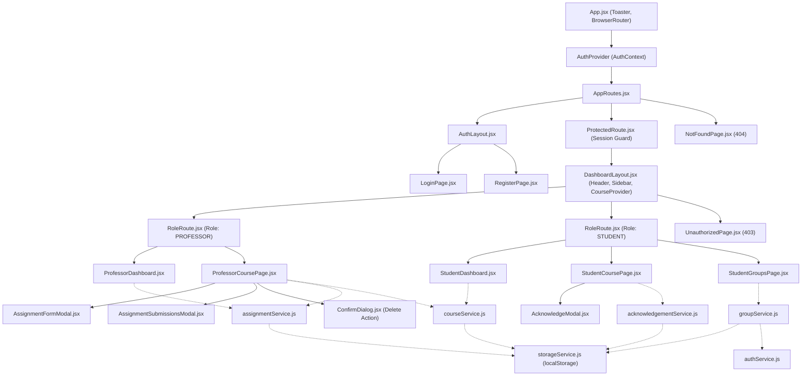

# Joineazy

A responsive web application for managing academic courses, assignment distribution, student project groups, and submission acknowledgements across professors and students.

[](https://react.dev/)
[](https://vite.dev/)
[](https://tailwindcss.com/)
[](https://reactrouter.com/)
[](https://www.netlify.com/)

---

## 1. Project Overview

Joineazy addresses the operational gap in academic course administration where professors distribute assignments and students collaborate in groups to submit deliverables. Built for higher education workflows, the platform provides dedicated role-based interfaces:

- **Professor Role**: Facilitates course overview, assignment authoring (title, instructions, deadlines, OneDrive links, modality), student/group submission tracking, dynamic progress bars, and submission log drill-downs.
- **Student Role**: Displays enrolled semester courses, active assignment deadlines, group collaboration hubs, and a two-step deliverable acknowledgement engine for individual and group submissions.

---

## 2. Key Features

### Authentication & Role-Based Access Control (RBAC)
- Login and registration forms with validation and inline error messaging.
- Role selection during registration (`Student` vs. `Professor`).
- Automatic role-based dashboard redirection after authentication.
- Simulated JWT session stored in `localStorage` with client-side expiration checks.
- Route protection guards (`ProtectedRoute`) and authorization guards (`RoleRoute`). Unauthenticated visits redirect to `/login`; unauthorized role visits redirect to `/unauthorized`.
- Working logout clearing active session data.

### Professor Dashboard & Course Management
- Displays all courses taught by the authenticated professor.
- Course cards displaying course code, title, term, enrolled student counts, and total published assignments.
- Dedicated course view (`/professor/courses/:courseId`) with keyword search, submission type filters (Individual / Group), status filters (Active / Overdue), and deadline sorting (Earliest / Latest).
- Full assignment authoring modal supporting Title, Description, Deadline (via `datetime-local`), OneDrive URL, and Modality.
- Edit assignment capability with pre-filled inputs.
- Delete assignment capability backed by a destructive confirmation dialog that cascade-removes associated student acknowledgements.
- Live submission tracking modal with overall progress bar (`X of Y completed`, percentage) and categorized drill-down tabs: **All**, **Submitted**, and **Not Submitted / Pending**.

### Student Dashboard & Course View
- Displays only the courses the logged-in student is currently enrolled in.
- Course summary cards with instructor name, total assignments, and active group membership.
- Course assignment view (`/student/courses/:courseId`) displaying title, instructions, formatted deadline, remaining time, OneDrive destination link, submission type badge, and live status badge.
- Semantic assignment statuses: **Pending**, **Submitted**, or **Overdue**.

### Individual Assignment Acknowledgement
- Action button labeled **"Yes, I have submitted"**.
- Triggers a verification modal where the student certifies deliverable upload to OneDrive.
- Records and stores an immutable ISO timestamp upon confirmation.
- Updates status across the card to `"Yes, I have submitted"` with `"Acknowledged on [Date and Time]"`.
- Disables further submissions to prevent duplicate acknowledgements.
- Persists state across browser refreshes via `localStorage`.

### Course Group Management
- Students can form a course-scoped team, automatically becoming the **Group Leader** (`👑`).
- Unassigned students can browse existing teams in that course and join in one click.
- Enforces strict business rules: prevents duplicate membership in the same course, prevents joining multiple groups per course, and prevents joining groups from other courses.
- Group view displays group name, creation date, leader identity, member count, and full member roster.

### Group Assignment Delegation & Synchronized Acknowledgement
- Group assignment cards clearly display the student's group status.
- **Unassigned State**: When a student has no group, the card displays:  
  `"You are not part of any group. Create or join one to submit this assignment."`  
  accompanied by a direct `"Create or Join Group"` button linking to the course group directory.
- **Leader Action**: Only the group leader can acknowledge a group assignment.
- **Member Visibility**: Regular members see the leader's identity and disabled controls stating:  
  `"Only the group leader ([Leader Name]) can acknowledge this assignment."`
- **Synchronized Status**: Once the leader submits, all members immediately see:  
  `"Acknowledged by [Leader Name] on [Date and Time]"` with further submissions locked.

### Responsive UI & Micro-Interactions
- Tested across mobile (320px–480px), tablet (768px–1024px), and desktop (1024px+).
- Mobile navigation drawer toggled via hamburger button.
- Reusable UI component library (Buttons, Inputs, Cards, Tables, Modals, Badges, Progress Bars).
- Non-blocking toast notifications powered by `react-hot-toast`.
- Zero placeholder or non-functional buttons.

---

## 3. Technology Stack

Verified against `frontend/package.json`:

| Category | Technology | Version | Purpose |
|---|---|---|---|
| **Runtime / Library** | React.js | `^19.3.1` | Declarative UI rendering, hooks, and component lifecycle |
| **DOM Renderer** | React DOM | `^19.3.1` | React mounting and reconciliation |
| **Build Tool** | Vite | `^8.3.6` | Development server, HMR, and Rollup production bundling |
| **Styling Framework** | Tailwind CSS | `^4.3.5` | Utility-first styling engine |
| **Vite Plugin** | `@tailwindcss/vite` | `^4.3.5` | Direct Tailwind integration with Vite |
| **Routing** | React Router DOM | `^7.18.5` | Declarative nested client-side routing and route guards |
| **State Management** | React Context API | Native | Global session (`AuthContext`) and sync bus (`CourseContext`) |
| **Iconography** | Lucide React | `^1.71.0` | SVG icons for navigation, status badges, and actions |
| **Notifications** | React Hot Toast | `^2.6.1` | Accessible toast alerts for operational feedback |
| **Utility Libraries** | `clsx` & `tailwind-merge` | `^2.1.1` / `^3.7.0` | Safe dynamic class concatenation (`cn` helper) |
| **Code Linter** | Oxlint | `^1.90.0` | Static code analysis and React compiler lint checks |

---

## 4. Project Structure

The React application is located inside the `/frontend` directory:

```
Joineazy/
├── netlify.toml                               # Root Netlify build & SPA routing configuration
├── README.md                                  # Technical documentation
└── frontend/
    ├── netlify.toml                           # Frontend-scoped Netlify configuration
    ├── package.json                           # Dependencies and build scripts
    ├── vite.config.js                         # Vite 8 config with React & Tailwind plugins
    ├── index.html                             # HTML entrypoint with metadata and favicon
    ├── public/
    │   ├── _redirects                         # Netlify SPA redirect rule (/* -> /index.html 200)
    │   └── favicon.svg                        # Vector graduation cap brand icon
    └── src/
        ├── constants/                         # Enums and configuration constants
        │   ├── roles.js                       # Roles: PROFESSOR, STUDENT
        │   ├── routes.js                      # Application route dictionary
        │   ├── submissionTypes.js             # Modalities: INDIVIDUAL, GROUP
        │   ├── assignmentStatuses.js          # Statuses: PENDING, SUBMITTED, OVERDUE
        │   └── storageKeys.js                 # LocalStorage partition keys
        ├── utils/                             # Pure helper functions
        │   ├── cn.js                          # Class merging utility
        │   ├── dateTime.js                    # Date formatting, deadline checks, countdowns
        │   ├── token.js                       # Base64 simulated JWT generation and parsing
        │   └── validation.js                  # Email, password, URL, and required field validators
        ├── services/                          # Business logic and relational mock API
        │   ├── storageService.js              # Safe LocalStorage read/write/remove handlers
        │   ├── seedData.js                    # Pre-seeded users, courses, assignments, and groups
        │   ├── authService.js                 # Authentication, registration, and session recovery
        │   ├── courseService.js               # Course queries and student enrollment filtering
        │   ├── assignmentService.js           # Assignment CRUD and submission stats aggregator
        │   ├── groupService.js                # Group creation, joining, and membership validation
        │   └── acknowledgementService.js      # Status evaluation engine for individual and group submissions
        ├── context/                           # React Context providers
        │   ├── AuthContext.jsx                # Global user authentication state and session methods
        │   └── CourseContext.jsx              # Cross-dashboard reactive data refresh trigger
        ├── hooks/                             # Custom consumer hooks
        │   ├── useAuth.js                     # Hook consuming AuthContext
        │   └── useCourseData.js               # Hook consuming CourseContext
        ├── components/
        │   ├── ui/                            # Atomic reusable UI components
        │   │   ├── Button.jsx                 # Styled button with 6 variants, sizes, and spinner
        │   │   ├── Input.jsx                  # Input field with label, icon, and error display
        │   │   ├── Textarea.jsx               # Multi-line text field for instructions
        │   │   ├── Select.jsx                 # Styled dropdown select control
        │   │   ├── Badge.jsx                  # Semantic status badges
        │   │   ├── Card.jsx                   # Card primitives (Header, Title, Content, Footer)
        │   │   ├── Modal.jsx                  # Accessible dialog with ESC listener and backdrop blur
        │   │   ├── ConfirmDialog.jsx          # Reusable confirmation dialog for critical actions
        │   │   ├── ProgressBar.jsx            # Dynamic progress bar with threshold color transitions
        │   │   ├── Table.jsx                  # Semantic tabular data grid
        │   │   ├── EmptyState.jsx             # Visual fallback for empty lists
        │   │   └── LoadingSpinner.jsx         # Loading spinner
        │   └── layout/                        # Layout chrome
        │       ├── Header.jsx                 # Top bar with user profile, role badge, and logout
        │       ├── Sidebar.jsx                # Collapsible desktop sidebar and mobile slide-out drawer
        │       └── StatCard.jsx               # Metric summary card
        ├── layouts/                           # Route wrapper layouts
        │   ├── AuthLayout.jsx                 # Split-screen auth container with demo credentials
        │   └── DashboardLayout.jsx            # Authenticated application shell with Header and Sidebar
        ├── pages/                             # Application views
        │   ├── auth/
        │   │   ├── LoginPage.jsx              # Sign-in form with 1-click demo presets
        │   │   └── RegisterPage.jsx           # Registration form with role picker
        │   ├── professor/
        │   │   ├── ProfessorDashboard.jsx     # Course catalog and high-level metric cards
        │   │   ├── ProfessorCoursePage.jsx    # Course assignments, filters, and authoring actions
        │   │   ├── AssignmentFormModal.jsx    # Modal for creating and editing assignments
        │   │   └── AssignmentSubmissionsModal.jsx # Drill-down submissions modal with status tabs
        │   ├── student/
        │   │   ├── StudentDashboard.jsx       # Enrolled course list and submission counters
        │   │   ├── StudentCoursePage.jsx      # Active assignments, status badges, and OneDrive links
        │   │   ├── StudentGroupsPage.jsx      # Team formation, discovery, and joining
        │   │   └── AcknowledgeModal.jsx       # Deliverable confirmation and acknowledgement dialog
        │   └── common/
        │       ├── NotFoundPage.jsx           # 404 route fallback
        │       └── UnauthorizedPage.jsx       # 403 role authorization block page
        ├── routes/                            # Route definitions and security wrappers
        │   ├── ProtectedRoute.jsx             # Session guard checking authentication
        │   ├── RoleRoute.jsx                  # Authorization guard verifying user role
        │   └── AppRoutes.jsx                  # Declarative route configuration
        ├── App.jsx                            # Root wrapper with Router, AuthProvider, and Toaster
        ├── index.css                          # Tailwind CSS base styles and font tokens
        └── main.jsx                           # Application entrypoint
```

---

## 5. Installation and Setup

### Prerequisites
- **Node.js**: `v18.0.0` or higher
- **npm**: `v9.0.0` or higher (or `pnpm`)

### Local Setup Steps

```bash
# 1. Clone the repository
git clone <repository-url>
cd Joineazy

# 2. Navigate into the frontend folder
cd frontend

# 3. Install dependencies
npm install

# 4. Start the Vite development server
npm run dev
```

The application will be accessible at `http://localhost:5173`.

### Production Build & Linting

```bash
# Run Oxlint static analysis
npm run lint

# Build production bundle into /frontend/dist
npm run build

# Preview production build locally
npm run preview
```

---

## 6. Demo Login Credentials

The application is pre-seeded with realistic demonstration accounts in `localStorage`. Interactive preset buttons are available on the login screen to populate credentials in one click:

| Role | Name | Email | Password | Pre-seeded Context |
|---|---|---|---|---|
| **Professor** | Dr. Sarah Jenkins | `professor@joineazy.edu` | `password123` | Teaches CS-401, CS-302, and CS-205 |
| **Student 1 (Leader)** | Alex Rivera | `student1@joineazy.edu` | `password123` | Enrolled in CS-401, CS-302, CS-205. Leader of "Distributed Pioneers" in CS-401 |
| **Student 2 (Member)** | Elena Chen | `student2@joineazy.edu` | `password123` | Enrolled in CS-401, CS-302. Member of "Distributed Pioneers" in CS-401 |
| **Student 3 (Solo)** | Marcus Vance | `student3@joineazy.edu` | `password123` | Enrolled in CS-401, CS-205. Not assigned to any group in CS-401 |

### Authentication & Storage Architecture
- When logging in, `authService.loginUser()` searches stored users, validates the password, and generates a simulated base64 JWT token containing `sub`, `email`, `role`, `name`, `iat`, and `exp` claims.
- The active session is stored under `joineazy_session` in `localStorage`.
- Protected routes decode the token on mount. If the token is missing, expired, or invalid, the session is cleared and the user is redirected to `/login`.
- If `localStorage` is cleared, `initializeDatabase()` re-populates the pre-seeded users, courses, assignments, and groups automatically.

---

## 7. Application Workflow

```
[Login Screen]
      │
      ├── Professor Credentials ──► [Professor Dashboard] ──► Select Course ──► [Course Assignments View]
      │                                                                               ├── Create / Edit Assignment Modal
      │                                                                               ├── Delete Assignment (Cascade Acks)
      │                                                                               └── View Submissions Modal (All / Submitted / Not Submitted)
      │
      └── Student Credentials ────► [Student Dashboard]   ──► Select Course ──► [Course Assignments View]
                                                                                      ├── Individual: "Yes, I have submitted" ──► Confirm Modal ──► Persist Timestamp
                                                                                      ├── Group (Leader): "Acknowledge for Group" ──► Synchronize Entire Team
                                                                                      ├── Group (Member): Read-only Status ("Acknowledged by [Leader] on [Time]")
                                                                                      └── Group (Unassigned): Prompt Notice ──► Navigate to [Groups Hub] ──► Create / Join
```

### Professor Workflow
1. Log in using `professor@joineazy.edu`.
2. The dashboard displays taught courses with enrolled student counts and published assignment tallies.
3. Click **"Manage Assignments"** on **CS-401**.
4. In the course view, filter by modality or status, or search assignments by title.
5. Click **"+ Create Assignment"** to open the modal, specify title, description, deadline datetime, OneDrive link, and modality (Individual or Group), and save.
6. Click **"Submissions"** on any assignment to inspect the live completion progress bar and toggle between **All**, **Submitted**, and **Not Submitted** student/group records.
7. Click **"Delete"** to open a confirmation dialog and remove an assignment and its records.

### Student Individual Submission Workflow
1. Log in using `student1@joineazy.edu`.
2. The dashboard lists enrolled courses and shows pending/completed metric cards.
3. Open **CS-401** and locate an Individual assignment (e.g. *Distributed Consensus Protocol*).
4. Click **"Yes, I have submitted"**.
5. In the confirmation dialog, check the certification box confirming deliverables are in OneDrive, and click **"Confirm & Acknowledge"**.
6. The card updates immediately to `"Yes, I have submitted"` with `"Acknowledged on [Date and Time]"`. Refreshing the browser confirms data persistence.

### Group Assignment & Leadership Workflow
1. While logged in as `student1@joineazy.edu` (Leader of "Distributed Pioneers" in CS-401), locate the Group assignment (*Kubernetes Cluster Orchestration*).
2. Click **"Acknowledge for Group"** and confirm. The submission is recorded on behalf of the group.
3. Log out and log in as `student2@joineazy.edu` (Member of "Distributed Pioneers").
4. Open **CS-401**. The assignment is marked submitted, displaying:  
   `"Acknowledged by Alex Rivera on [Date and Time]"`  
   with action buttons locked to prevent duplicate submissions.
5. Log out and log in as `student3@joineazy.edu` (Marcus Vance, unassigned in CS-401).
6. Open **CS-401**. The group task displays:  
   `"You are not part of any group. Create or join one to submit this assignment."`
7. Click **"Create or Join Group"** to navigate to `/student/courses/:courseId/groups` where Marcus can join an existing team or create a new team to become leader.

---

## 8. Design Decisions

- **Tailwind CSS v4 Utility Architecture**: Styling is executed exclusively with Tailwind CSS utility classes and `@tailwindcss/vite`, avoiding bloated external UI frameworks and runtime CSS-in-JS overhead.
- **Visual Distinction by Role**: Indigo primary tokens denote Professor capabilities; Purple accent tokens denote Student contexts, providing clear orientation across the portal.
- **Relational Integrity over Static Mocking**: Rather than hardcoding submission numbers, submission counts and progress percentages are computed dynamically from stored relation tables (`joineazy_assignments`, `joineazy_individual_acknowledgements`, `joineazy_group_acknowledgements`).
- **Reactive State Bus (`CourseContext`)**: Write operations trigger a state version increment in `CourseContext`, causing subscribed views to re-calculate metrics without needing a full-page reload.
- **Accessibility & Tactile Feedback**: All interactive elements feature active compression states (`active:scale-[0.98]`), focus rings (`focus:ring-3 focus:ring-indigo-500/15`), semantic HTML headings, and keyboard `Escape` closing on modals.
- **Zero-Comment Source Code**: Application source code (`.js`, `.jsx`, `.css`) contains zero comments, relying on descriptive function names, self-explanatory variable naming, and strict separation of concerns.

---

## 9. Screenshots and GIFs

*(Place recorded screenshots or GIFs in `frontend/src/assets/screenshots/` using the suggested filenames below)*

| View | Filename | Description |
|---|---|---|
| **Authentication Screen** | `01-login-screen.png` | Split-screen authentication view with 1-click demo credential pills |
| **Professor Dashboard** | `02-professor-dashboard.png` | Course catalog with enrolled student counts and published assignment stats |
| **Assignment Management** | `03-professor-course-page.png` | Course view with search, modality filter, status filter, and deadline sorting |
| **Submission Drill-Down** | `04-submissions-modal.png` | Modal showing progress bar and All / Submitted / Not Submitted tabs |
| **Student Dashboard** | `05-student-dashboard.png` | Enrolled semester courses with pending and completed metric cards |
| **Individual Acknowledgement**| `06-student-acknowledgement.png` | Two-step submission confirmation and timestamp display |
| **Group Hub & Membership** | `07-group-management.png` | Course group directory with leader crown indicator and member chips |

---

## 10. Live Demo and Repository

- **GitHub Repository**: [TODO: Insert your GitHub repository URL here, e.g. `https://github.com/your-username/Joineazy`]
- **Live Deployed Application (Netlify)**: [TODO: Insert your Netlify deployment URL here, e.g. `https://your-site.netlify.app`]
- **Demo Video Walkthrough (3–5 min)**: [TODO: Insert your public Loom or Google Drive video link here]

---

## 11. Known Limitations

- **Client-Side Simulation**: Because a backend server was out of scope for this technical round, authentication sessions use simulated base64 JWT tokens verified client-side, and records persist in browser `localStorage`.
- **Browser-Scoped Storage**: Data is isolated to the specific browser instance. Resetting browser storage re-initializes the application to the pre-seeded demo dataset.
- **OneDrive Link Redirection**: OneDrive links are stored and validated as external URLs; direct file streaming or Microsoft Graph OAuth integration is not implemented.

---

## 12. Future Improvements

- **Backend Integration**: Replace the mock service layer with a Node.js/Express or NestJS REST/GraphQL API with real PostgreSQL/Prisma persistence.
- **Direct Deliverable File Uploads**: Integrate AWS S3 or Cloudflare R2 bucket uploads with drag-and-drop file previews alongside OneDrive links.
- **Real-Time WebSockets**: Implement WebSocket or Server-Sent Events (SSE) so professor dashboards update live when a student submits without client polling.
- **Batch Exporting**: Allow professors to export student submission logs to CSV or Excel for gradebook integration.

---

## 13. Author

- **Candidate**: [TODO: Insert your name here]
- **GitHub**: [TODO: Insert your GitHub profile link here]
- **Email**: [TODO: Insert your contact email here]

---

## 14. Component Architecture Diagram


